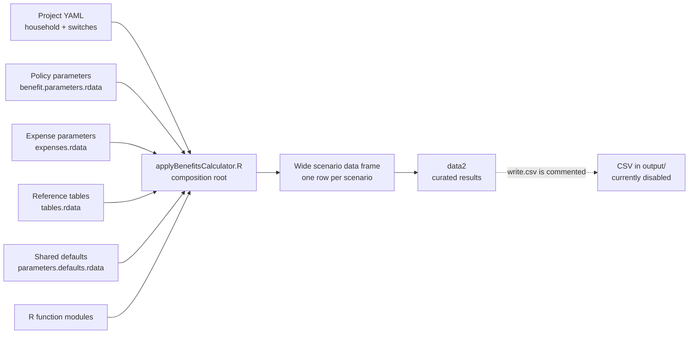
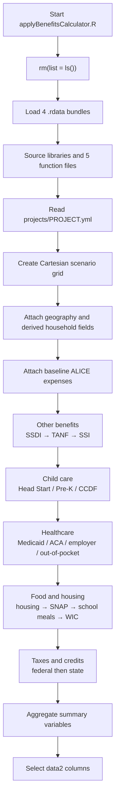
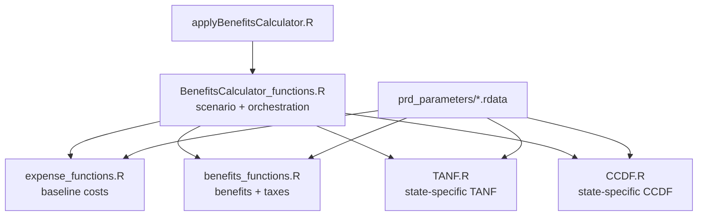

# Policy Rules Database: Architecture Map

> Local companion document. This file describes the repository as inspected on
> 2026-09-16 at commit `f17b0cc` on `main`. It is intentionally descriptive,
> not a claim that every current behavior is intended.

## Purpose

The Policy Rules Database (PRD) is a batch microsimulation engine written in R.
Given a household specification, geography, policy year, income range, and a set
of program switches, it creates household scenarios and estimates expenses,
public benefits, taxes, tax credits, after-tax income, and net resources.

Despite the name, the repository is not a database server or web application.
Its durable policy data is stored in `.rdata` bundles, and its executable surface
is an R script plus a set of functions that transform one wide data frame.

This document is the high-level map. The technical manual remains the source for
program definitions, and the R code and parameter bundles remain the executable
source of truth.

## One-minute mental model

1. `projects/<PROJECT>.yml` describes one or more household scenarios.
2. `applyBenefitsCalculator.R` loads four parameter bundles and all functions.
3. `function.createData()` expands YAML vectors into a Cartesian product: one
   row per income/location/household/policy-year combination.
4. Each calculator block adds or replaces columns on that same wide data frame.
5. Later blocks depend on columns produced by earlier blocks.
6. `function.createVars()` combines benefits, taxes, income, and expenses into
   summary measures.
7. A curated `data2` data frame is created. In the inspected version, the line
   that writes `output/results_<PROJECT>.csv` is commented out.



## Repository map

```text
policy-rules-database/
├── applyBenefitsCalculator.R         # executable composition root
├── libraries.R                       # package installation/loading side effects
├── functions/
│   ├── BenefitsCalculator_functions.R # scenario creation and block orchestration
│   ├── benefits_functions.R           # individual benefit/tax rule functions
│   ├── expense_functions.R            # ALICE and healthcare expense functions
│   ├── TANF.R                         # state-specific TANF engine
│   └── CCDF.R                         # state-specific child-care subsidy engine
├── prd_parameters/
│   ├── benefit.parameters.rdata       # policy rules used by the main script
│   ├── expenses.rdata                 # cost/expense datasets
│   ├── tables.rdata                   # geography and threshold crosswalks
│   └── parameters.defaults.rdata      # shared calendar/default constants
├── projects/
│   └── TEST.yml                       # example run specification
├── output/
│   └── results_*.csv                  # checked-in example/generated results
├── README.md                          # user quick start
├── PRD Technical Manual - 07-12-2024.pdf
├── PRD_Update_Schedule.md             # policy-data maintenance calendar
├── PSL_catalog.json                   # external catalog metadata
├── benefit.parameters.rdata           # second, non-identical root-level copy
└── .github/workflows/test.yml         # CI definition; see caveats below
```

The five function files contain about 27,700 lines. Most complexity is
concentrated in the state-by-state `TANF.R` and `CCDF.R` engines.

## Architectural layers

| Layer | Responsibility | Primary files | Contract |
|---|---|---|---|
| Run specification | Household, location, years, income range, feature switches | `projects/*.yml` | Named YAML fields, usually vectors or scalars |
| Composition root | Clears the session, loads data/code, chooses a project, orders calculator blocks, selects output | `applyBenefitsCalculator.R` | A run from the repository root produces `data` and `data2` in memory |
| Orchestration | Builds scenarios and coordinates groups of related policies | `functions/BenefitsCalculator_functions.R` | Accept and return the evolving wide data frame |
| Rule engines | Implement program eligibility, amounts, expenses, taxes, and credits | `functions/benefits_functions.R`, `expense_functions.R`, `TANF.R`, `CCDF.R` | Read required columns and loaded parameter objects; return vectors, small frames, or the enriched frame |
| Policy data | Versioned parameters, rates, thresholds, crosswalks, and expense estimates | `prd_parameters/*.rdata` | Named R objects loaded into the run environment |
| Presentation/export | Select user-facing columns and optionally persist them | tail of `applyBenefitsCalculator.R`, `output/` | `data2`; intended `results_<PROJECT>.csv` |

## Runtime lifecycle



### 1. Bootstrap

`applyBenefitsCalculator.R` assumes the current working directory is the
repository root. It clears the active R environment, then loads:

- `prd_parameters/expenses.rdata`
- `prd_parameters/benefit.parameters.rdata`
- `prd_parameters/tables.rdata`
- `prd_parameters/parameters.defaults.rdata`

It then sources `libraries.R` and all five function files. The functions rely on
objects introduced by those `load()` calls, so load order and object names are
part of the runtime contract even though they are not explicit function
arguments.

### 2. Project configuration

The `PROJECT` string selects `projects/<PROJECT>.yml`; it is hard-coded to
`"TEST"` in the inspected script. The script copies switches and settings from
the parsed YAML list into top-level variables.

The YAML contains two kinds of input:

- Scenario dimensions: policy year, location, household member ages and
  disabilities, marital status, income sources, assets, housing, and employer
  health coverage.
- Model configuration: budget type, child-care modes, continuous-eligibility
  settings, and `APPLY_*` program switches.

### 3. Scenario construction

`function.createData(inputs)` uses `expand.grid()`. Multiple values are crossed,
not paired. For example, 3 locations × 101 income values × 2 policy years creates
606 rows before any other multi-valued fields are considered.

It then calls `function.InitialTransformations()` to:

- split `"County, ST"` into county/town and state abbreviation;
- join county and metropolitan-area crosswalks;
- derive family size, adult/child counts, youngest-child age, Alaska/Hawaii
  classification, total assets, and tax filing status;
- allocate earned income equally among adult household members for disability
  calculations; and
- initialize current and prior-year income fields.

### 4. Baseline expenses

`BenefitsCalculator.ALICEExpenses()` attaches gross household costs before
subsidies: child care, transportation, food, school meals, WIC, technology,
housing, utilities, healthcare, and miscellaneous expenses. It uses the global
`budget.ALICE` setting to choose survival, stability, or CLIFF-oriented expense
behavior.

### 5. Benefit and tax blocks

The composition root applies blocks in this exact order:

| Order | Orchestrator | Programs or decisions | Important downstream output |
|---:|---|---|---|
| 1 | `BenefitsCalculator.OtherBenefits()` | SSDI, TANF, SSI | Disability and cash-assistance values; SSI history flags |
| 2 | `BenefitsCalculator.Childcare()` | Head Start, Early Head Start, Pre-K, CCDF | `value.*` child-care fields and `netexp.childcare` |
| 3 | `BenefitsCalculator.Healthcare()` | Medicaid/CHIP, ACA subsidy, employer plan, out-of-pocket | Chosen healthcare source, gross/net healthcare cost, subsidy values |
| 4 | `BenefitsCalculator.FoodandHousing()` | Section 8/RAP/FRSP, SNAP, school meals, WIC | Net housing, utility, and food expenses |
| 5 | `BenefitsCalculator.TaxesandTaxCredits()` | Federal/state income tax, FICA, EITC, CTC, CDCTC | Taxes and federal/state credit values |
| 6 | `function.createVars()` | Cross-program totals | `AfterTaxIncome`, `SelfSufficiency`, `NetResources` |

### 6. Final calculations and projection

`function.createVars()` computes:

```text
AfterTaxIncome
  = earned + gift + investment + child-support income
    - federal income tax - state income tax - FICA

NetResources
  = earned + gift + investment + child-support income
    + employer-healthcare value + total transfers
    - total taxes - total expenses
```

The composition root then selects identity, household, expense, benefit, tax,
credit, and summary columns into `data2`.

## Core data contract

The central integration surface is a single wide R data frame named `data`.
There are no domain objects or service boundaries: modules communicate by
creating, reading, and overwriting columns.

### Row grain

One row represents one simulated household at one location, income value, rule
year, and combination of any other vector-valued YAML inputs.

### Important column families

| Family | Examples | Created by |
|---|---|---|
| Scenario identity | `ruleYear`, `Year`, `stateFIPS`, `stateName`, `countyortownName`, `stcountyfips2010` | scenario construction and lookup tables |
| Household | `famsize`, `numadults`, `numkids`, `agePerson1` … `agePerson12`, disability/blindness flags | YAML plus initial transformations |
| Income/assets | `income`, `income_tm12`, `income1` … `income6`, gifts, investment, child support, cash/car assets | YAML plus initial transformations |
| Gross expenses | `exp.childcare`, `exp.food`, `exp.healthcare`, `exp.rentormortgage`, `exp.utilities`, `exp.transportation`, `exp.tech`, `exp.misc` | expense and healthcare blocks |
| Net expenses | `netexp.childcare`, `netexp.food`, `netexp.healthcare`, `netexp.rentormortgage`, `netexp.utilities` | benefit blocks after subsidies |
| Benefit values | `value.snap`, `value.tanf`, `value.ssi`, `value.CCDF`, `value.medicaid`, `value.aca`, etc. | program functions and orchestrators |
| Taxes/credits | `tax.income.fed`, `tax.income.state`, `tax.FICA`, federal/state EITC, CTC, CDCTC | tax block |
| Summaries | `total.transfers`, `total.taxes`, `total.expenses`, `AfterTaxIncome`, `NetResources` | `function.createVars()` |

### Household conventions

- The schema supports up to 12 household members through repeated numbered
  columns rather than a separate person table.
- Ages 19 and above count as adults; ages 18 and below count as children in the
  initial transformation.
- Earned income is divided equally among detected adults for individual
  disability calculations.
- SSDI PIA and blindness inputs are modeled explicitly only for persons 1–6.
- `ruleYear` selects policy rules. `Year` is used extensively by expense and
  continuous-eligibility logic.
- Missing or ineligible values are often normalized to zero by orchestrators,
  but individual rule functions sometimes use `NA` to mean unavailable or
  ineligible. The distinction is context-dependent.

### Common join dimensions

Parameter lookups repeatedly use combinations of:

- time: `ruleYear` or `Year`;
- geography: `stateFIPS`, `stateName`, `stateAbbrev`, `stcountyfips2010`, or
  `countyortownName`;
- household: `famsize`, `numadults`, `numkids`, or `numkidsinCare`;
- special geography: `AKorHI`; and
- tax status: `FilingStatus` and number of qualifying children.

Changing the meaning, type, or naming of any of these keys has repository-wide
impact.

## Module and function map

### Orchestration functions

| Function | Direct project-function dependencies |
|---|---|
| `function.createData` | `function.InitialTransformations` |
| `BenefitsCalculator.ALICEExpenses` | all expense functions |
| `BenefitsCalculator.Childcare` | `function.headstart`, `function.prek`, `function.CCDFcopay` |
| `BenefitsCalculator.Healthcare` | ALICE/Medicaid/exchange expense functions, `function.medicaid`, `function.aca` |
| `BenefitsCalculator.OtherBenefits` | `function.ssdiBenefit`, `function.tanfBenefit`, `function.ssiBenefit` |
| `BenefitsCalculator.FoodandHousing` | Section 8/RAP/FRSP, SNAP, school meals, WIC functions |
| `BenefitsCalculator.TaxesandTaxCredits` | federal/state tax, FICA, EITC, CTC, and CDCTC functions |
| `function.createVars` | no program calls; aggregates columns |



### Program-level functions in `benefits_functions.R`

- Cash/disability: SSDI and SSI.
- Food/housing: SNAP, WIC, Section 8, Connecticut RAP, DC FRSP, DC CareerMAP,
  and school meals.
- Early care/education: Head Start and Pre-K.
- Health: Medicaid and ACA subsidies.
- Taxes/credits: federal and state income tax, FICA, federal/state EITC,
  federal/state CTC, and federal/state CDCTC.

TANF and CCDF are separated because their state-specific branching is much
larger than the other programs. Each is still exposed as one top-level function:
`function.tanfBenefit(data)` and `function.CCDFcopay(data, contelig.ccdf)`.

## Parameter architecture

| Bundle | Representative objects | Used for |
|---|---|---|
| `benefit.parameters.rdata` | `snapData`, `tanfData`, `medicaidData`, `section8Data`, federal/state tax and credit data, one `ccdfData_*` frame per state | Eligibility thresholds, benefit amounts, tax rules, premiums, state-specific schedules |
| `expenses.rdata` | ALICE child-care, food, housing, healthcare, technology, and transportation frames | Baseline costs by year, household, and geography |
| `tables.rdata` | county/state maps, metro map, FPL, SMI, minimum wage, missing-estimate table | Geography enrichment, thresholds, crosswalks, fallback support |
| `parameters.defaults.rdata` | one-row `parameters.defaults` frame | Shared calendar/day-count and other default constants |

The runtime loads whole bundles, not a program-specific subset. Functions then
refer to named objects in their enclosing/global environment. This makes the
object names and schemas an implicit API.

Several functions synthesize requested future years by copying the most recent
available parameter row. That fallback is implemented independently in multiple
functions; it is policy behavior, not merely a loading detail.

## Ordering invariants and hidden coupling

These are structural rules to preserve unless a deliberate redesign changes the
contracts:

1. SSDI precedes TANF because TANF treats SSDI as unearned income.
2. SSI follows SSDI because SSI uses allocated SSDI/auxiliary amounts.
3. Baseline expenses precede all subsidies; subsidy blocks calculate net costs
   from gross costs.
4. Child-care precedes taxes because CDCTC uses `netexp.childcare`.
5. Medicaid, SNAP, and TANF must precede WIC eligibility/value logic.
6. SNAP precedes school meals and WIC because each successively reduces
   `netexp.food`.
7. Housing assistance creates net rent and utility costs used in summaries.
8. Every disabled program path must still create zero-valued columns expected by
   `function.createVars()` and the final `select()`.
9. `plyr` is intentionally loaded before `dplyr` at the end of `libraries.R` to
   control masking. Changing package load order can change behavior.

## Output contract

The intended public artifact is `output/results_<PROJECT>.csv`. The selected
columns cover:

- location, rule year, and household composition;
- earned income and cash assets;
- gross and net expense categories;
- benefit values across food, housing, healthcare, child care, disability, and
  TANF;
- federal/state taxes and credits; and
- `AfterTaxIncome` and `NetResources`.

As currently checked out, `data2` is created but `write.csv(...)` is commented,
so running the script does not refresh the CSV automatically.

## Change-impact guide

| Change | Inspect together | Minimum validation |
|---|---|---|
| Add or change a YAML field | `projects/*.yml`, `applyBenefitsCalculator.R`, `function.createData`, affected block | One scalar case and one multi-valued case; confirm row count and wiring |
| Update a benefit rule | Relevant parameter object, program function, orchestrator zero/take-up path, technical manual | Boundary cases immediately below/at/above each threshold and years |
| Update expense data | `expenses.rdata`, matching expense function, ALICE budget modes | Known county/household/year in all supported budget modes |
| Change geography keys | `tables.rdata`, initial transformations, every join using affected key | At least one normal state plus Alaska/Hawaii and a renamed/special geography |
| Change household schema | scenario creation and all repeated person-number logic | Household sizes 1, 2, 6, and 12; adult/child boundary ages 18/19 |
| Change block order | all upstream/downstream columns in this document | End-to-end comparison across several programs; explain semantic change |
| Add a program | parameters, rule function, orchestrator switch/zero path, totals, final selection, docs/tests | Disabled/enabled cases, eligibility boundaries, interactions, take-up |
| Change tax logic | current and `_tm12` paths, federal/state dependency, credits, summaries | Filing statuses, child counts, refundable/nonrefundable limits, phase-ins/outs |

## Current-state caveats verified from the code

These are observations to resolve or preserve consciously. They are not inferred
from the README.

1. **SSI and SSDI switches are crossed at the composition root.**
   `BenefitsCalculator.OtherBenefits` declares arguments in the order TANF,
   SSDI, SSI, but `applyBenefitsCalculator.R` passes TANF, SSI, SSDI. Enabling
   only one of SSI or SSDI therefore selects the other branch.
2. **The tax switch is not passed.** The script reads `APPLY_TAXES` from YAML,
   but omits it when calling `BenefitsCalculator.TaxesandTaxCredits`; the
   function default is `TRUE`.
3. **Several YAML child-care settings are not wired into the call.** Continuous
   eligibility and FT/PT variables are assigned at the top level, but the
   `BenefitsCalculator.Childcare` call omits them and therefore uses function
   defaults. Baseline child-care expenses also hard-code summer care to `"PT"`.
4. **`Year` in YAML is not used by scenario construction.**
   `function.createData()` sets `Year = ruleYear`.
5. **`prev_ssi` in YAML is not used by scenario construction.** The constructed
   value is hard-coded to `0`.
6. **`USEALICE` is read but not referenced elsewhere in the R code.**
7. **README/output behavior differs.** The README says results are saved to CSV,
   while the only `write.csv` line is commented out.
8. **There are two non-identical `benefit.parameters.rdata` files.** The main
   script loads the copy under `prd_parameters/`; the root-level copy is not
   referenced and contains different dimensions for several objects.
9. **The tracked CI workflow refers to missing tests.** It changes into `tests/`
   and sources `BenefitsCalculator_Unittest.R` and `run_tests.R`, but no files
   under `tests/` are tracked in this checkout.
10. **Runtime package management is side-effectful and unpinned.** `libraries.R`
    installs many packages if absent, loads a broader Shiny/reporting stack than
    the batch entry point visibly needs, and loads `pivottabler` and `ggiraph`
    without corresponding installation guards.
11. **The entry point destroys interactive state.** `rm(list=ls())` clears the
    caller's global environment before a run.
12. **The system depends on the working directory and global objects.** Functions
    cannot be safely understood or executed in isolation without recreating the
    loaded parameter/configuration environment.

## Maintenance protocol for this map

Update this document whenever a change affects any of the following:

- the composition-root call order;
- function/module ownership;
- YAML fields or their wiring;
- parameter bundle names, object names, or join keys;
- central data-frame column contracts;
- output columns or persistence behavior; or
- testing/deployment structure.

For each structural change:

1. Change the architecture section in the same work session as the code.
2. Verify the diagram arrows against actual calls, not comments.
3. Verify every configuration field from YAML to the function that consumes it.
4. Record intentional ordering dependencies next to the relevant block.
5. Add or update a boundary test before considering the map current.
6. Re-check the "Current-state caveats" list and remove items only when the code
   has actually changed.

## Suggested architecture decisions to make next

These are the highest-leverage decisions for reducing future maintenance cost:

1. Declare one authoritative parameter directory and remove or formally explain
   the root-level duplicate.
2. Replace positional calls between the composition root and orchestrators with
   named arguments.
3. Pass one explicit configuration object instead of relying on global settings.
4. Separate package declaration/installation from execution and pin versions.
5. Define and test a formal input schema and an output schema.
6. Restore a tracked, runnable test suite with small fixtures for policy boundary
   cases and a minimal end-to-end smoke run.
7. Gradually replace repeated person-number columns and state branches with
   data-driven tables where policy semantics allow it.

## Glossary

| Term | Meaning in this repository |
|---|---|
| ALICE | Expense estimates used to construct household survival/stability budgets |
| CCDF | Child Care and Development Fund subsidy |
| CLIFF | Downstream Career Ladder Identifier and Financial Forecaster tooling |
| CTC / CDCTC / EITC | Child Tax Credit / Child and Dependent Care Tax Credit / Earned Income Tax Credit |
| FPL / SMI | Federal Poverty Level / State Median Income |
| FRSP / RAP | DC Family Rehousing and Stabilization Program / Connecticut Rental Assistance Program |
| PIA | Primary Insurance Amount used by SSDI calculations |
| PRD | Policy Rules Database |
| SLP | School lunch/breakfast program switch in the composition root |
| TANF / SSI / SSDI | Cash and disability assistance programs |

---

### Validation note

All seven R source files parsed successfully with R 4.5.1 during this review.
The full model was not executed because sourcing `libraries.R` can install
packages and the checked-out test files referenced by CI are absent. The maps
above were verified against function definitions, direct call relationships,
parameter-bundle contents, and the composition-root code.
